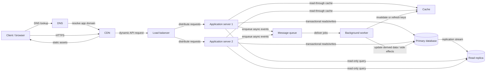

# QuickNotes System Architecture

## Scope

The current project is a browser-based frontend demonstration that reads, creates, and deletes posts through JSONPlaceholder. The architecture below is a proposed production-ready design; none of its custom backend infrastructure is currently deployed.

## Functional requirements

- Create notes with a required title and optional body.
- View a user's notes and retrieve an individual note.
- Delete notes and, in a production API, replace or partially update notes.
- Validate input, including a title from 1 to 100 characters after trimming.
- Show loading, success, and error status messages in the client.
- Handle HTTP errors and network failures without losing a usable interface.
- Enforce user authentication and ownership for private notes in production.

## Non-functional requirements

- **Performance:** return common note lists quickly, bound payload size, and cache safe reads.
- **Scalability:** add stateless application instances and scale data services against observed load.
- **Availability:** distribute application instances and use managed, replicated infrastructure where possible.
- **Security:** TLS, authentication, ownership checks, input validation, rate limits, and protected credentials.
- **Maintainability:** versioned API contracts, modular services, schema migrations, and consistent errors.
- **Reliability:** transactions, retries where safe, monitoring, backups, and tested recovery procedures.

## Traffic and storage estimates

These are planning assumptions, not measured usage or a capacity guarantee. Assume 1,000,000 registered users, 10% daily active users (100,000), 20 API requests per active user per day, a 90% read / 10% write mix, and a 10x peak-to-average multiplier. Use 30-day months and 365-day years for simple arithmetic.

- Daily requests: `100,000 active users × 20 = 2,000,000 requests/day`.
- Average rate: `2,000,000 ÷ 86,400 seconds/day ≈ 23.1 requests/second`.
- Average reads: `23.1 × 0.90 ≈ 20.8 reads/second`; writes: `23.1 × 0.10 ≈ 2.3 writes/second`.
- Estimated peak: `23.1 × 10 ≈ 231 requests/second`; approximately 208 reads/s and 23 writes/s at the same mix.

Assume 50 notes per registered user, and about 2 KiB per stored note for title, body, identifiers, and row overhead. This deliberately excludes indexes, replicas, backups, logs, and object storage.

- Initial note count: `1,000,000 users × 50 notes/user = 50,000,000 notes`.
- Initial primary note data: `50,000,000 × 2 KiB = 100,000,000 KiB ≈ 95.4 GiB` (about 100 GB decimal).
- If active users create an average of 0.2 notes/day: `100,000 × 0.2 × 365 = 7,300,000 new notes/year`.
- Annual note-data growth: `7,300,000 × 2 KiB = 14,600,000 KiB ≈ 13.9 GiB/year` (about 15 GB decimal).

Real provisioned capacity must include indexes, metadata, replicas, backup retention, peak bursts, and operational headroom; retention and update behavior also affect storage growth.

## Proposed architecture

The flow labels show intended paths; implementations may route selected reads to the replica only when replication lag is acceptable. The CDN may serve static files and cache only public or otherwise safely keyed responses.

## Components

| Component | Role and problem solved |
|---|---|
| Client/browser | Renders the note UI and sends HTTPS requests; keeps interaction responsive. |
| DNS | Maps the application hostname to the CDN edge service. |
| CDN | Serves static assets close to users and absorbs eligible cacheable traffic. |
| Load balancer | Health-checks and distributes API traffic among application instances. |
| Application servers | Validate requests, authenticate users, enforce ownership, and implement API behavior. Multiple stateless instances support horizontal scaling. |
| Cache | Stores short-lived, frequently requested data to reduce database load and latency. |
| Primary database | Source of truth for transactional note, user, and tag data. |
| Read replica | Serves eligible read traffic and can provide a warm recovery target, subject to replication lag and failover design. |
| Message queue | Buffers asynchronous work and decouples request handling from slower side effects. |
| Background worker | Processes queued tasks such as notifications, exports, and search indexing away from the user request. |

## Request flows

### `GET /notes`

1. The browser resolves the API domain through DNS and sends an HTTPS request via the CDN and load balancer.
2. A healthy application server authenticates the caller, validates cursor and page-size parameters, and scopes the query to that user's notes.
3. The application checks a cache key that includes the user and pagination parameters. On a valid hit it returns the cached page.
4. On a miss, it reads from the primary or a sufficiently current read replica using an indexed, bounded query, stores the result for a short TTL, and returns JSON with pagination metadata.
5. Cache failures should degrade to the database where safe. Replica lag or cache invalidation policy may require reading from primary after a recent write.

### `POST /notes`

1. The browser sends JSON over HTTPS through the CDN and load balancer.
2. The application authenticates the user, validates content type, title and body limits, and derives ownership from the identity rather than a client-supplied owner ID.
3. It inserts the note in a primary-database transaction and returns `201 Created` with the note and `Location` header after commit.
4. It publishes an event to the queue, ideally through a transactional outbox so a committed note cannot lose its asynchronous event. A worker handles optional search indexing or notifications.
5. The application invalidates or refreshes affected cache entries. Queue/worker failure should be retried and monitored without falsely reporting an uncommitted note as created.

## Scalability and reliability

- **Application servers:** keep instances stateless and add/remove them behind health-checked load balancing; store sessions in a shared secure mechanism if sessions are used.
- **Database:** index ownership and sort paths, inspect query plans, use connection pooling, and direct eligible reads to replicas. Replicas do not replace backups and can be stale.
- **Caching:** use bounded TTLs and explicit invalidation or versioned keys; define consistency behavior after writes and tolerate cache outages.
- **Queues and jobs:** use durable queues, bounded retries, dead-letter handling, idempotent workers, and an outbox for reliable event publication.
- **Monitoring and logging:** track latency, error rate, saturation, queue age, database connections, replica lag, and cache hit rate. Use request IDs and redact note content, credentials, and tokens from logs.
- **Backups and recovery:** take encrypted automated backups and point-in-time recovery snapshots, keep copies in a separate failure domain, define recovery time/point objectives, and regularly test restoration and failover.

## Single points of failure

| Potential failure point | Mitigation |
|---|---|
| One application process | Run multiple instances across independent hosts/zones with health checks and automated replacement. |
| One load balancer or CDN endpoint | Use managed highly available services and redundant edge/network configuration; verify DNS failover behavior. |
| Primary database | Use managed HA/failover across zones, tested promotion of a replica, and independent backups. Writes may pause during promotion. |
| Cache cluster | Deploy a replicated/managed cache where needed; application can fall back to the database with rate and load protection. |
| Queue or worker | Use durable replicated queueing, multiple workers, retry/dead-letter policies, and alerting on queue age. |
| DNS provider/account | Use a resilient provider setup, protect account access, and plan tested recovery for domain configuration incidents. |

These controls reduce risk; they do not eliminate provider-wide outages, correlated failures, bad deployments, or data corruption.

## Trade-offs

1. **Cache speed versus freshness:** caching reduces latency and database work, but invalidation and TTL choices can expose stale lists after writes. Short TTLs and targeted invalidation improve freshness at the cost of cache churn and more database reads.
2. **Relational transactions versus horizontal distribution:** SQL constraints and transactions make ownership and tag associations reliable, but a single primary can constrain write scaling and cross-region latency. Start with a well-indexed primary and replicas; partition or shard only when measurements justify added operational complexity.
3. **Synchronous work versus queued work:** returning after a database commit keeps the request simple and predictable, while asynchronous side effects improve response time. Queues add eventual consistency, retries, duplicate delivery, and operational components that workers must handle idempotently.

## Current implementation versus proposed architecture

The current project is a frontend demonstration using JSONPlaceholder at `https://jsonplaceholder.typicode.com/posts`. It implements GET, POST, and DELETE requests from the browser; JSONPlaceholder simulates writes and does not permanently persist created or deleted posts. The frontend has title validation and status/error messaging. It has no deployed custom API, authentication, cache, database, queue, worker, load balancer, or read replica. The architecture and estimates above describe a proposed production system only.
