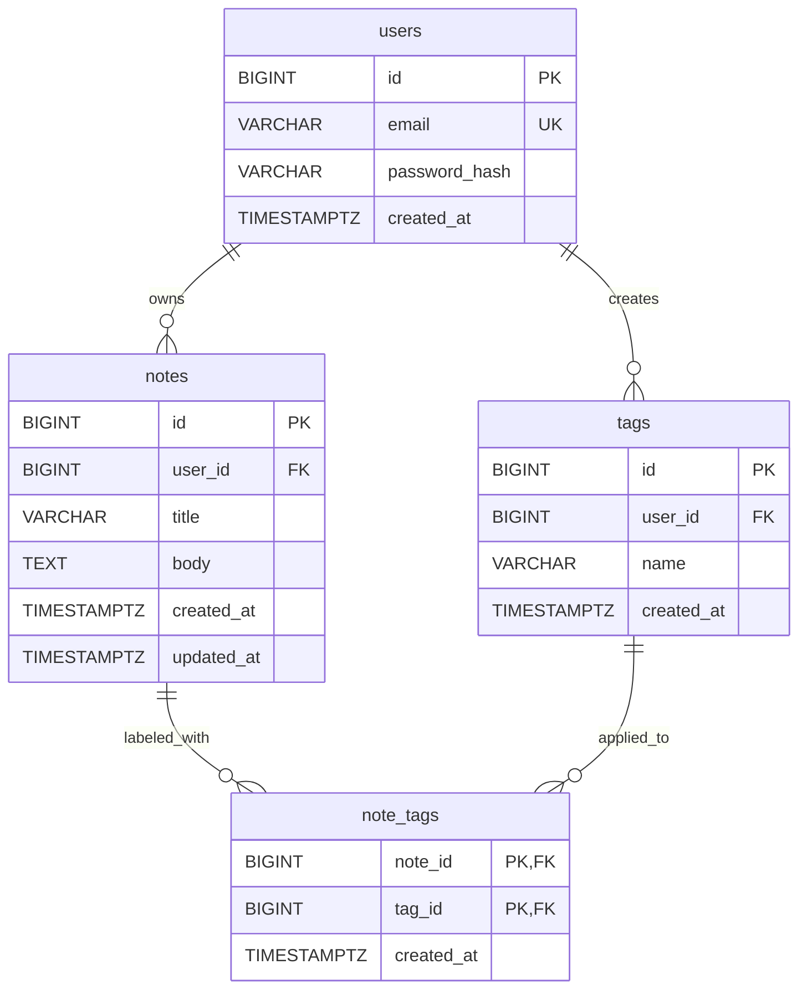

# QuickNotes Data Model

## Data model overview

This is a proposed relational database design for a production QuickNotes service. A user owns notes; users cannot read or mutate another user's notes. Tags are reusable labels, and a note may have many tags while a tag may be attached to many notes. `note_tags` represents that many-to-many association. The current JSONPlaceholder frontend does not use these tables.

## Tables

### `users`

| Column | SQL type | Constraints | Purpose |
|---|---|---|---|
| `id` | BIGINT GENERATED ALWAYS AS IDENTITY | Primary key | Internal user identifier. |
| `email` | VARCHAR(254) | NOT NULL, UNIQUE | Login/contact identifier. |
| `password_hash` | VARCHAR(255) | NOT NULL | Password hash; never store a raw password. |
| `created_at` | TIMESTAMPTZ | NOT NULL, DEFAULT CURRENT_TIMESTAMP | Account creation time. |

### `notes`

| Column | SQL type | Constraints | Purpose |
|---|---|---|---|
| `id` | BIGINT GENERATED ALWAYS AS IDENTITY | Primary key | Note identifier. |
| `user_id` | BIGINT | NOT NULL, FK to `users(id)` ON DELETE CASCADE | Owning user. |
| `title` | VARCHAR(100) | NOT NULL, CHECK non-empty after trim | Note title. |
| `body` | TEXT | NOT NULL, DEFAULT empty string | Note content. |
| `created_at` | TIMESTAMPTZ | NOT NULL, DEFAULT CURRENT_TIMESTAMP | Creation time. |
| `updated_at` | TIMESTAMPTZ | NOT NULL, DEFAULT CURRENT_TIMESTAMP | Last update time; application updates it on edits. |

### `tags`

| Column | SQL type | Constraints | Purpose |
|---|---|---|---|
| `id` | BIGINT GENERATED ALWAYS AS IDENTITY | Primary key | Tag identifier. |
| `user_id` | BIGINT | NOT NULL, FK to `users(id)` ON DELETE CASCADE | Owner, keeping tags private to a user. |
| `name` | VARCHAR(50) | NOT NULL, CHECK non-empty after trim | Display name of the tag. |
| `created_at` | TIMESTAMPTZ | NOT NULL, DEFAULT CURRENT_TIMESTAMP | Tag creation time. |
| `(user_id, name)` | — | UNIQUE | Prevent duplicate tag names per user. |

### `note_tags`

| Column | SQL type | Constraints | Purpose |
|---|---|---|---|
| `note_id` | BIGINT | NOT NULL, FK to `notes(id)` ON DELETE CASCADE | Related note. |
| `tag_id` | BIGINT | NOT NULL, FK to `tags(id)` ON DELETE CASCADE | Related tag. |
| `created_at` | TIMESTAMPTZ | NOT NULL, DEFAULT CURRENT_TIMESTAMP | Time the association was created. |
| `(note_id, tag_id)` | — | Composite primary key | Prevent duplicate assignment. |

## Relationships

- One user can have many notes; every note belongs to exactly one user.
- A user owns their tags. Notes and tags have a many-to-many relationship.
- `note_tags` is the junction table and its composite primary key prevents duplicate links.
- The schema uses PostgreSQL syntax and `TIMESTAMPTZ` for timezone-aware timestamps.



## Proposed production SQL schema

```sql
CREATE TABLE users (
    id BIGINT GENERATED ALWAYS AS IDENTITY PRIMARY KEY,
    email VARCHAR(254) NOT NULL UNIQUE,
    password_hash VARCHAR(255) NOT NULL,
    created_at TIMESTAMPTZ NOT NULL DEFAULT CURRENT_TIMESTAMP
);

CREATE TABLE notes (
    id BIGINT GENERATED ALWAYS AS IDENTITY PRIMARY KEY,
    user_id BIGINT NOT NULL REFERENCES users(id) ON DELETE CASCADE,
    title VARCHAR(100) NOT NULL CHECK (char_length(btrim(title)) BETWEEN 1 AND 100),
    body TEXT NOT NULL DEFAULT '',
    created_at TIMESTAMPTZ NOT NULL DEFAULT CURRENT_TIMESTAMP,
    updated_at TIMESTAMPTZ NOT NULL DEFAULT CURRENT_TIMESTAMP
);

CREATE TABLE tags (
    id BIGINT GENERATED ALWAYS AS IDENTITY PRIMARY KEY,
    user_id BIGINT NOT NULL REFERENCES users(id) ON DELETE CASCADE,
    name VARCHAR(50) NOT NULL CHECK (char_length(btrim(name)) BETWEEN 1 AND 50),
    created_at TIMESTAMPTZ NOT NULL DEFAULT CURRENT_TIMESTAMP,
    CONSTRAINT tags_user_name_unique UNIQUE (user_id, name)
);

CREATE TABLE note_tags (
    note_id BIGINT NOT NULL REFERENCES notes(id) ON DELETE CASCADE,
    tag_id BIGINT NOT NULL REFERENCES tags(id) ON DELETE CASCADE,
    created_at TIMESTAMPTZ NOT NULL DEFAULT CURRENT_TIMESTAMP,
    PRIMARY KEY (note_id, tag_id)
);
```

## Example queries

Retrieve recent notes belonging to one user:

```sql
SELECT id, title, body, created_at, updated_at
FROM notes
WHERE user_id = 42
ORDER BY updated_at DESC, id DESC
LIMIT 50;
```

Retrieve one note with its tags while enforcing ownership:

```sql
SELECT n.id, n.title, n.body, t.id AS tag_id, t.name AS tag_name
FROM notes AS n
LEFT JOIN note_tags AS nt ON nt.note_id = n.id
LEFT JOIN tags AS t ON t.id = nt.tag_id
WHERE n.id = 9001 AND n.user_id = 42
ORDER BY t.name;
```

Create a note and assign an existing user's tag atomically:

```sql
BEGIN;
WITH new_note AS (
    INSERT INTO notes (user_id, title, body)
    VALUES (42, 'Release checklist', 'Confirm deployment steps.')
    RETURNING id
)
INSERT INTO note_tags (note_id, tag_id)
SELECT new_note.id, tags.id
FROM new_note
JOIN tags ON tags.id = 7 AND tags.user_id = 42;
COMMIT;
```

The first query pages through a user's notes; the second returns a note and any labels without losing notes that have none; the third creates the note and links the user's tag in one transaction. A production handler should confirm the expected tag association was made and roll back on failure.

## Indexing

- The user primary key and unique email constraint create indexes for identity lookup.
- Add `CREATE INDEX notes_user_updated_idx ON notes (user_id, updated_at DESC, id DESC);` to accelerate a user's ordered note list and pagination.
- `note_tags` primary key indexes lookup by `note_id`; add `CREATE INDEX note_tags_tag_note_idx ON note_tags (tag_id, note_id);` for finding notes by tag.
- `tags_user_name_unique` supports a user's tag name lookup. Add indexes based on measured query patterns and write overhead.

## SQL versus NoSQL

A relational database is a good fit when users, notes, and tags have clear relationships, ownership constraints matter, and note creation/tag assignment needs transactions and referential integrity. PostgreSQL offers expressive joins, constraints, and indexing for these access patterns.

A NoSQL database can be useful when access is primarily by a known key, schema flexibility is important, or partitioned horizontal throughput outweighs relational joins. It may simplify distribution but can require duplicated data and application-managed consistency. For an initial production QuickNotes service, this relational schema is a reasonable starting point; capacity and real query patterns should guide later tuning or a complementary store.
